# Database ERD

MySQL 8, `utf8mb4_unicode_ci`. All tables have `id` primary keys and `created_at`/`updated_at` unless noted.
Soft deletes (`deleted_at`) on: users, categories, collections, products, media_assets, pages, lookbooks, customers, enquiries, orders.
Migrations: `backend/database/migrations`.

```mermaid
erDiagram
    users ||--o{ role_user : has
    roles ||--o{ role_user : grants
    roles ||--o{ permission_role : has
    permissions ||--o{ permission_role : in

    departments ||--o{ categories : contains
    categories ||--o{ categories : "parent of"
    size_charts ||--o{ categories : "default chart"
    categories ||--o{ category_product : ""
    products ||--o{ category_product : ""
    collections ||--o{ collection_product : ""
    products ||--o{ collection_product : ""
    occasions ||--o{ occasion_product : ""
    products ||--o{ occasion_product : ""
    tags ||--o{ product_tag : ""
    products ||--o{ product_tag : ""
    products ||--o{ product_relations : "related / complete the look"
    departments ||--o{ products : ""
    size_charts ||--o{ products : "override"

    product_options ||--o{ product_option_values : "size / colour values"
    products ||--o{ product_variants : "size × colour matrix"
    product_option_values ||--o{ product_variants : "size_value_id / color_value_id"
    products ||--o{ product_media : gallery
    media_assets ||--o{ product_media : ""
    media_assets ||--o{ product_variants : "variant image"

    attributes ||--o{ attribute_values : options
    attributes ||--o{ attribute_category : "schema per category"
    categories ||--o{ attribute_category : ""
    products ||--o{ product_attribute_values : ""
    attributes ||--o{ product_attribute_values : ""
    attribute_values ||--o{ product_attribute_values : ""

    customers ||--o{ enquiries : ""
    users ||--o{ enquiries : "assigned_to"
    enquiries ||--o{ enquiry_items : ""
    products ||--o{ enquiry_items : "snapshot source"
    product_variants ||--o{ enquiry_items : ""
    enquiries ||--o{ enquiry_status_histories : ""
    enquiries ||--o{ enquiry_notes : ""
    enquiries ||--o| orders : "converted to"
    customers ||--o{ orders : ""
    orders ||--o{ order_items : ""
    orders ||--o{ order_status_histories : ""

    lookbooks ||--o{ lookbook_media : ""
    media_assets ||--o{ lookbook_media : ""
    collections ||--o{ lookbooks : ""
    navigation_menus ||--o{ navigation_items : ""
    navigation_items ||--o{ navigation_items : "children"
```

## Tables

| Table | Purpose | Notable columns & constraints |
|---|---|---|
| `users` | Staff accounts | unique `email`; `is_active`; encrypted `two_factor_secret`, hashed recovery codes |
| `roles`, `permissions`, `permission_role`, `role_user` | RBAC | unique `slug`; `roles.requires_mfa` |
| `media_assets` | Uploaded originals + renditions | `uuid` unique; `disk`, `path`; `renditions` JSON (derived paths); `checksum` (dedupe); `kind`; `alt_text`; `processing_status` |
| `departments` | Women, Men, Bridal, Accessories… | unique `slug` |
| `categories` | Nestable taxonomy | FK department (restrict), self FK `parent_id` (restrict); **unique `path`** (scopes slug to parent) |
| `collections`, `occasions`, `tags` | Independent groupings | unique `slug`; collections have season window `starts_at/ends_at` |
| `category_product` / `collection_product` / `occasion_product` / `product_tag` | Many-to-many | composite PKs; `is_primary`, `sort_order` where relevant; cascade only the pivot row |
| `products` | Catalogue items | unique `slug`, `sku`; `status`, `published_at`; `price_mode` (fixed / starting_from / on_request); internal `cost_price`, `internal_notes`; denormalised `min_price`, `has_stock`, `search_text` (FULLTEXT on MySQL) |
| `product_options` / `product_option_values` | Size & colour dictionaries | unique `(product_option_id, code)`; `hex`, `size_group`, `is_custom` |
| `product_variants` | Real size × colour combinations | unique `sku`; unique `(product_id, combination_key)`; `stock_quantity`, `stock_policy`, optional `price`, `media_asset_id` |
| `product_media` | Ordered gallery | `role` (gallery/alternate/detail/video), `color_value_id`, `alt_text`, `sort_order`; media FK restrict |
| `attributes` / `attribute_values` / `attribute_category` / `product_attribute_values` | Typed attribute schema | `is_filterable` drives storefront facets |
| `size_charts` | Display chart + guide | `chart` JSON table; `guide_media_id` (PDF) |
| `product_relations` | Related / complete the look | PK `(product_id, related_product_id, type)` |
| `redirects` | 301/302/410 | unique `from_path`; chains collapse automatically |
| `homepage_sections` | CMS sections | `draft_config` / `config` JSON, draft & live order/visibility, schedule window |
| `pages` | CMS pages | unique `slug`; sanitised `body`; `template` |
| `navigation_menus` / `navigation_items` | Admin-managed menus | unique `location`; items link by type + id or URL; 3 levels |
| `lookbooks` / `lookbook_media` | Campaign stories | links to collection / product |
| `testimonials` | Genuine client words | published only when `is_approved` **and** `consent_confirmed` |
| `newsletter_subscribers` | Opt-in list | unique `email`, `unsubscribe_token`, `consented_at` |
| `settings` | Typed key/value | unique `key`; `is_public` |
| `customers` | Contacts (voluntary) | `anonymized_at`; marketing consent timestamp |
| `enquiries` | Enquiry intents | unique `reference`, `summary_token`; `status`; `assigned_to`; `follow_up_at`; encrypted `measurements`; UTM only with consent; hashed IP |
| `enquiry_items` | Snapshots | product/variant FKs nullOnDelete + name/SKU/size/colour/price snapshot |
| `enquiry_status_histories`, `enquiry_notes` | Lead audit trail | |
| `orders` | Manually confirmed orders | unique `reference`; `enquiry_id`; `status`, `payment_status` (manual); totals; `stock_committed` |
| `order_items`, `order_status_histories` | Agreed prices and audit | |
| `analytics_events` | First-party, consented events | no personal data; `session_hash` |
| `activity_logs` | Admin audit log | redacts secrets/measurements |
| `product_imports` | CSV import runs | dry-run preview, per-row errors |
| Laravel tables | `sessions`, `cache`, `jobs`, `failed_jobs`, `password_reset_tokens`, `personal_access_tokens` | |

**Deletion safety:** deleting a category or collection never deletes products (only pivot rows); categories with children
and media in use cannot be deleted; products are soft-deleted and restorable; customer anonymisation keeps orders/enquiries.
